# After Dusk

After Dark-style screen savers for the Apple II.

After Dusk turns an Apple II into an ambient display that matches a vintage Mac running After
Dark. It plays 14 silent, black-and-white screen savers in random order, about three minutes each,
until you switch it off.

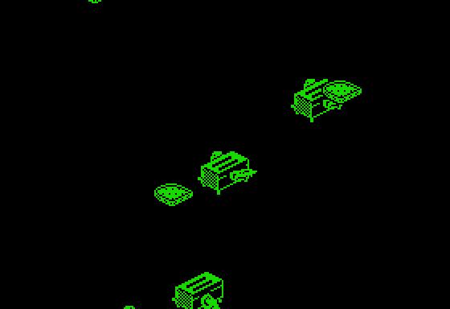

## The effects

Each is new code, as close to the After Dark original as a 1 MHz Apple II can draw.

| | | |
|---|---|---|
| <br>**Flying Toasters** | 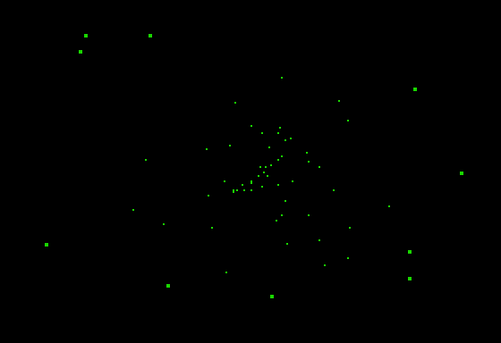<br>**Warp** | 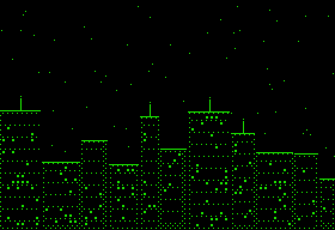<br>**Starry Night** |
| 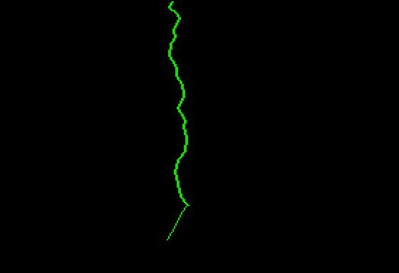<br>**Zot!** | 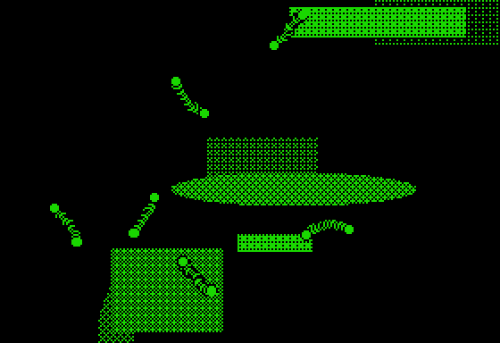<br>**Can of Worms** | 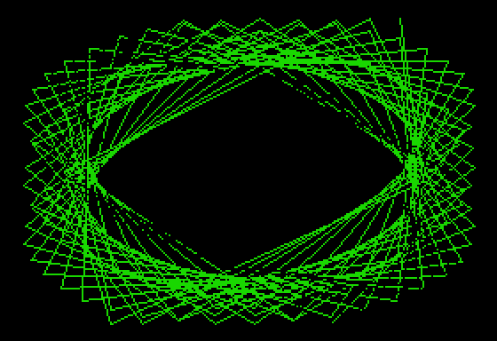<br>**Lissajous** |
| 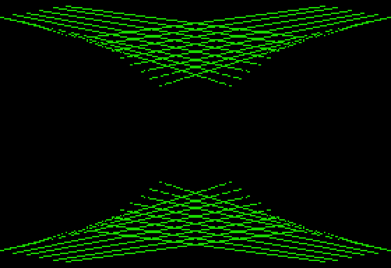<br>**Nightlines** | 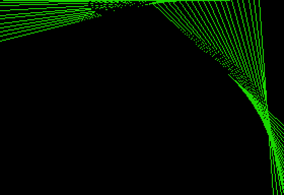<br>**String Theory** | 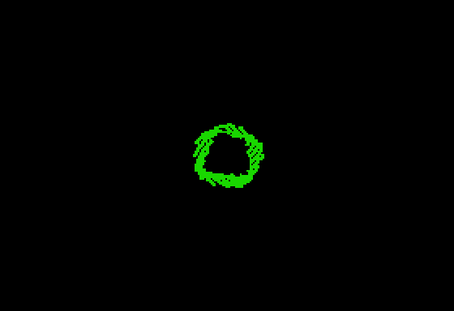<br>**Rose** |
| 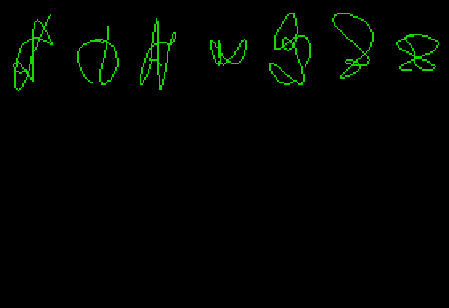<br>**Doodles** | 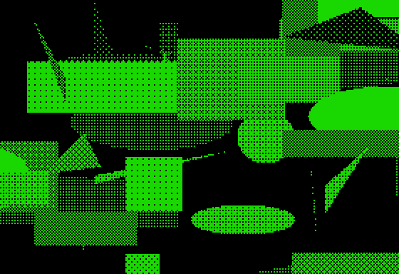<br>**Shapes** | 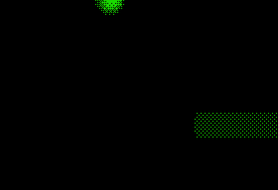<br>**Spheres** |
| 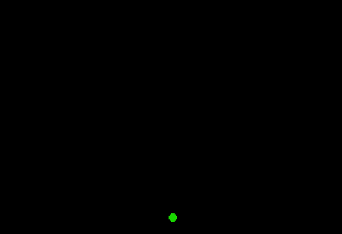<br>**Bouncing Ball** | 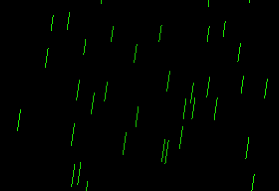<br>**Rainstorm** | |

These were recorded in MAME. Can of Worms crawls over whatever the last effect left.

## Wait, why would an Apple II need a screen saver?

It doesn't. Screen savers were for computers left on all day, like an idle Mac. A picture left on
a CRT for hours can burn in permanently, so screen savers blanked it or kept something moving.
After Dark (1989) made that fun to watch.

An Apple II runs one program, then gets switched off, so it rarely needed one. After Dusk gives it
a job anyway, as a desk toy or ambient display.

## What you need

- An Apple IIc, IIc Plus, or enhanced IIe with 128K. It won't run on an Apple II, II+ or
  unenhanced IIe.
- A FloppyEmu or other drive emulator, or a floppy written with ADTPro or similar.

It has been tested on a real IIc with a FloppyEmu, and in MAME on a IIc and enhanced IIe. On
the IIe, some effects run up to about a fifth too fast or slow. It hasn't been tried on a IIc
Plus, IIgs or real floppy drive. A IIgs should run it at Normal speed, set in the
Control Panel; at Fast, effects would probably run two or three times too fast.

## Getting it

Download `AFTERDUSK.dsk` from the [latest release](../../releases/latest) and boot it. The first
effect starts in about half a minute.

- **Skip an effect:** press any key.
- **Start over:** Ctrl-Reset.
- **Stop:** switch the computer off. There's no menu or way back to BASIC.

## Building it

You need [cc65](https://cc65.github.io/) and Python 3. The tests also need
[MAME](https://www.mamedev.org/) and your own Apple IIc ROM images (see `tests/README.md`).

```bash
tools/bootstrap.sh                 # once, into .tools/
./build.sh                         # writes build/AFTERDUSK.dsk
.tools/venv/bin/pytest tests -q
tools/make-gifs.sh                 # the GIFs above
```

`AGENTS.md` documents the memory layout and the rules for effects.

## A homage to After Dark

After Dusk is a homage to Berkeley Systems' After Dark for the Mac. Each effect was modeled on
the original running in Afterglow; Rose also follows the method the
[after-dark](https://github.com/Vortitron/after-dark) project describes.

Other homages and revivals:

- [Afterglow](https://morphing.cloud/afterglow): the original modules on modern macOS.
- [Rose](https://www.sticksoftware.com/software/Rose.html): revived for macOS by its author.
- [Flying Toasters](https://www.flyingtoasters.greggant.com/): for modern macOS and PowerPC Macs.
- [After Dark in CSS](https://bryanbraun.github.io/after-dark-css/): several in a browser.
- [flying-toasters-xscreensaver](https://github.com/torunar/flying-toasters-xscreensaver): for
  XScreensaver on Linux.

## License

After Dusk's code is MIT-licensed (see [LICENSE](LICENSE)). The disk also includes Apple's DOS
3.3, which isn't (see [THIRD-PARTY-NOTICES.md](THIRD-PARTY-NOTICES.md)).
